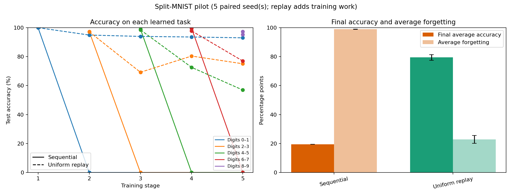
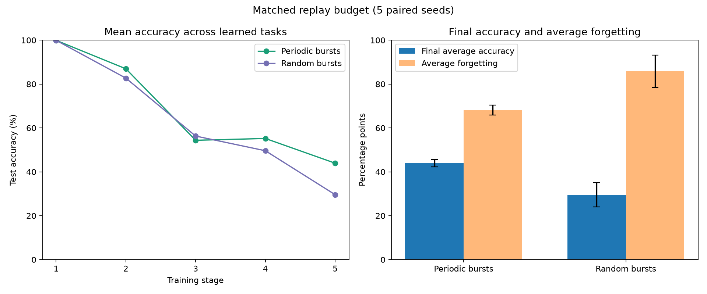
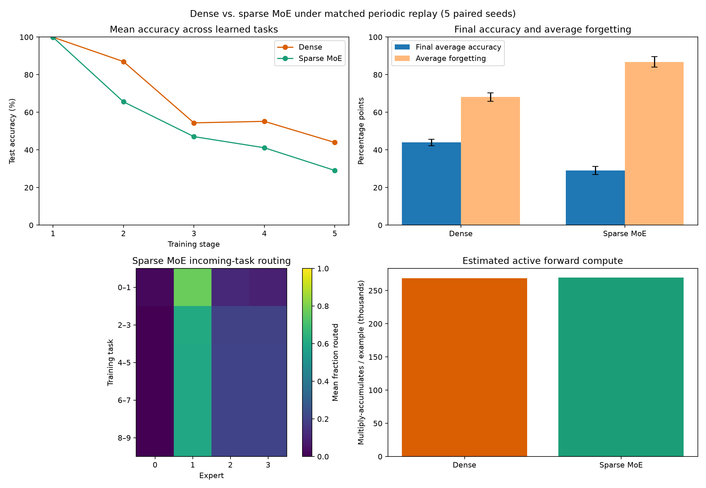
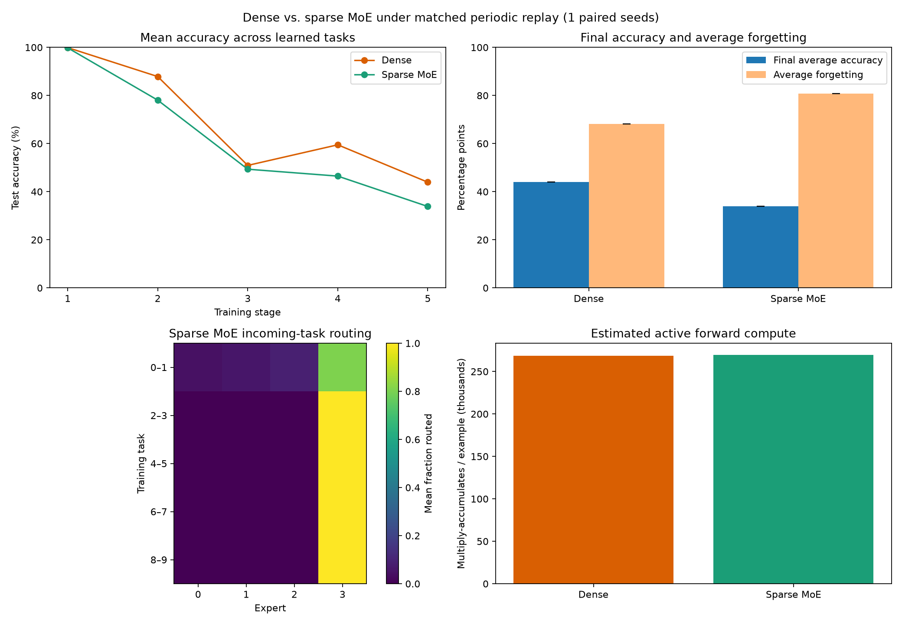
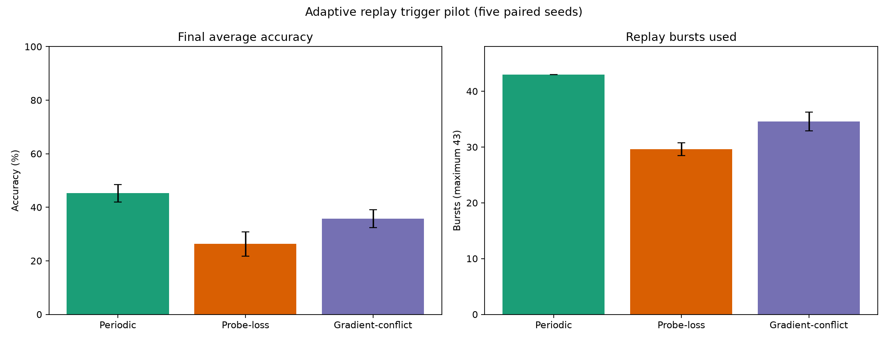

# Adaptive Sleep Replay: Empirical Continual Learning Pilots

> **Working Title:** *When Is Replay Worth Its Cost? Evaluating Forgetting-Triggered Consolidation in Continual Learning*
> **Author:** Daksh Verma (Chitkara University)
> **Status:** Proposal + Split-MNIST Replay-Scheduling and MoE Pilots

---

## Overview

Continual learning requires a neural network to acquire new skills across sequential tasks without catastrophically forgetting earlier ones. While experience replay mitigates forgetting, both replay updates and scheduling monitors consume compute.

This repository contains the experimental protocol, reproducible PyTorch pipelines, and multi-seed empirical pilots investigating **replay burst scheduling** and **sparse Mixture-of-Experts (MoE) routing dynamics** under tightly controlled memory and compute budgets.

---

## Summary of Empirical Pilots (Split-MNIST, 5 Paired Seeds: 42–46)

All primary comparisons use 3 epochs per task (180,000 incoming examples, 1,413 incoming optimizer steps per seed) and a 500-example reservoir buffer.

| Phase | Experiment / Condition | Hardware | Replay Examples / Seed | Total Steps / Seed | Final Avg. Accuracy | Avg. Forgetting |
| :--- | :--- | :--- | ---: | ---: | ---: | ---: |
| **Phase 1** | Sequential (No Replay) | Tesla T4 | 0 | 1,413 | 19.45 ± 0.01% | 98.89 ± 0.10 pp |
| **Phase 1** | Mixed Uniform Replay | Tesla T4 | 45,184 | 1,413 | **79.39 ± 1.98%** | **22.84 ± 2.75 pp** |
| **Phase 2** | Periodic Replay Bursts ($k=25$) | Tesla T4 | 1,376 (43 bursts) | 1,456 | **43.94 ± 1.71%** | **68.18 ± 2.25 pp** |
| **Phase 2** | Random Replay Bursts (Matched Budget) | Tesla T4 | 1,376 (43 bursts) | 1,456 | 29.60 ± 5.54% | 85.85 ± 7.33 pp |
| **Phase 3a** | Sparse MoE (Bottleneck 32, Periodic) | Tesla T4 | 1,376 (43 bursts) | 1,456 | 34.02 ± 5.19% | 80.68 ± 6.45 pp |
| **Phase 3b** | Dense Baseline (Compute-Matched Control) | RTX 3050 | 1,376 (43 bursts) | 1,456 | **43.95 ± 1.71%** | **68.17 ± 2.25 pp** |
| **Phase 3b** | Sparse MoE (Active-MAC Matched within 0.38%) | RTX 3050 | 1,376 (43 bursts) | 1,456 | 29.08 ± 2.24% | 86.82 ± 2.82 pp |

### Key Findings So Far
1. **Burst Timing Matters (Phase 2):** Under a strict budget of 43 single-step replay bursts (1,376 examples), periodic placement outperforms random placement on all five seeds (**+14.35 pp** mean accuracy, **−17.68 pp** forgetting).
2. **MoE Router Collapse Under Continual Shifts (Phase 3):** Replacing the dense layer with a 4-expert top-1 Sparse MoE with Switch-style load balancing ($\alpha = 0.01$) degrades accuracy by **−14.87 pp** even when active forward MACs per example are matched within **0.38%** (269,824 vs. 268,800 MACs). Four-window chronological diagnostics show maximum expert load saturating to **97.3%–100%** by Task 2 alongside gate probability saturation (~0.987). This identifies a failure mode in this configuration but does not establish a unique cause.

### Phase 3c: Router Intervention Pilot

A one-seed RTX 3050 pilot combined training-only router-logit noise (`std=0.1`) with router z-loss (`coefficient=0.001`). Seed-42 MoE accuracy was **33.85%** versus **32.19%** in the original run, but routing still collapsed to **~100%** on a single expert by Task 2 and later. This is an exploratory result, not evidence that the intervention improves performance. See the [Phase 3c report](artifacts/PHASE_03C_ROUTER_RESULTS.md).

### Phase 4: Adaptive Replay Trigger Pilot

The five-seed RTX 3050 run compared periodic replay with fixed-probe loss-spike and gradient-conflict triggers. Periodic replay reached **45.25 ± 3.23%** accuracy with 43 bursts. Loss-triggered replay used **29.6 bursts** on average and reached **26.29 ± 4.59%**; gradient-conflict replay used **34.6 bursts** and reached **35.69 ± 3.33%**. Both adaptive methods used fewer replay examples but had worse retention; total runtime was similar (14.76–15.09 s). This at-most-budget pilot neither matched realized replay nor establishes H1/H2. See the [Phase 4 report](artifacts/PHASE_04_RESULTS.md) and [protocol](experiments/phase-04-adaptive-replay.md).

---

## Visual Diagnostics

### Phase 1: Sequential vs. Uniform Replay (3 Epochs/Task)

### Phase 2: Periodic vs. Random Replay Bursts

### Phase 3 Diagnostic: Active-Compute-Matched Dense vs. Sparse MoE

### Phase 3c: Router Noise + Z-Loss Pilot

### Phase 4: Adaptive Replay Triggers

---

## Repository Structure

* [`proposal/proposal.md`](proposal/proposal.md) — Formal undergraduate research proposal, hypotheses ($H_1, H_2$), and evaluation design.
* [`notebooks/adaptive_sleep_replay_lab.ipynb`](notebooks/adaptive_sleep_replay_lab.ipynb) — Version-controlled Colab lab notebook for reproducing experiments.
* [`experiments/`](experiments/README.md) — Executable scripts, protocol specifications, and unit tests.
* [`artifacts/`](artifacts/) — JSON logs, environment metadata, plots, and detailed phase reports:
  * [Phase 1 Baseline Report](artifacts/RESULTS.md)
  * [Phase 2 Periodic vs. Random Burst Report](artifacts/PHASE_02_RESULTS.md)
  * [Phase 3 Original MoE Pilot](artifacts/PHASE_03_RESULTS.md)
  * [Phase 3 Compute-Matched Router Diagnostic](artifacts/PHASE_03_DIAGNOSTIC_RESULTS.md)
  * [Phase 3c Router Intervention Pilot](artifacts/PHASE_03C_ROUTER_RESULTS.md)
  * [Phase 4 Adaptive Replay Trigger Pilot](artifacts/PHASE_04_RESULTS.md)
* [`notes/`](notes/) — [Research decision](notes/research-decision.md), [beginner learning guide](notes/learning-guide.md), and [annotated literature map](notes/literature-map.md).
